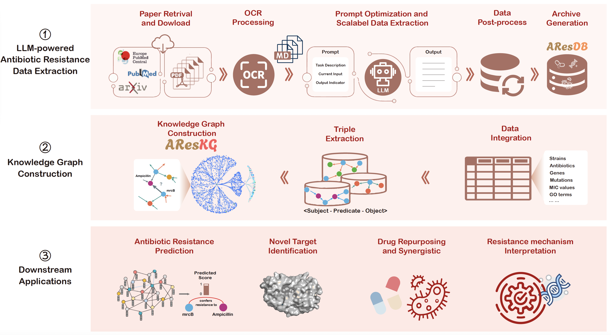
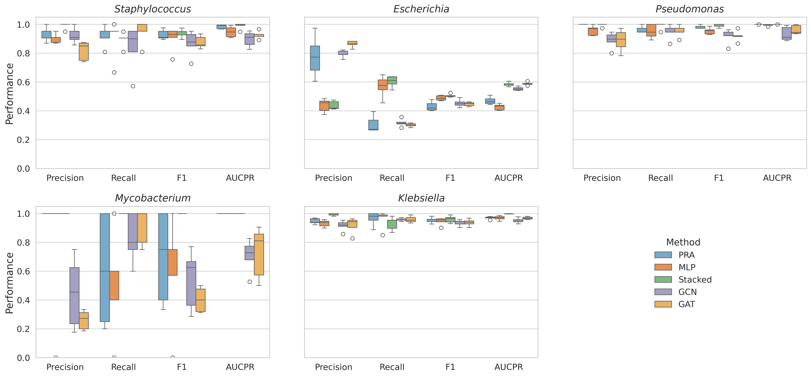
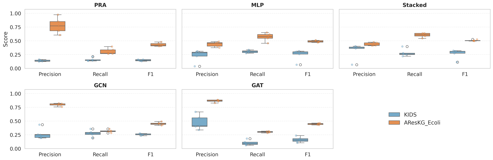

# LLM-powered construction of antibiotic resistance datasets and knowledge graphs for accelerated antibiotic resistance gene discovery

<p align="center">
  
</p>


<p align="center">
  <a href="#installation">Installation</a> •
  <a href="#quick-start">Quick Start</a> •
  <a href="#pipeline-overview">Pipeline</a> •
  <a href="#configuration">Configuration</a> •
  <a href="#data-format">Data Format</a> •
  <a href="#downstream-resistance-prediction--benchmarking">Resistance Prediction</a> •
  <a href="#citation">Citation</a>
</p>

---

## 📌 Overview

This repository provides a complete, reproducible pipeline for:

1. **Retrieving** open-access scientific articles via keyword search on Europe PMC / arXiv
2. **Converting** PDFs and supplementary materials to machine-readable Markdown
3. **Extracting** structured antibiotic resistance data using LLMs
4. **Integrating & cleaning** extracted records into a standardized database
5. **Constructing** a multi-relational knowledge graph
6. **Benchmarking** link-prediction models (PRA / MLP / Stacked / GCN / GAT) on top of AResKG for antibiotic resistance gene discovery

> Current release (v1.0, 2026)
>
> **AResDB** contains 22,414 experimental samples spanning 2,769 strains, 3,379 compounds, 359 genes, 468 mutations, and 352 resistance mechanisms.
>
> **AResKG** contains 51,704,105 triples across 14 entity types and 27 relation types.

### Repository Contents

- **`script/`** : the LLM-powered data extraction pipeline (Steps 1–6, see [Quick Start](#quick-start) below): paper retrieval → PDF→Markdown → LLM extraction → integration → post-processing → KG construction.
- **`demo/` / `figure/` / `results/`** : downstream resistance-gene link-prediction benchmarking suite (PRA, MLP, Stacked, GCN, GAT) built on top of AResKG; see [Downstream: Resistance Prediction & Benchmarking](#downstream-resistance-prediction--benchmarking).
- **`environment.yaml`** : unified conda environment covering both the upstream LLM extraction pipeline and the downstream GNN resistance-prediction pipeline.
- **`script/prompt/`** : prompt used for data extraction.

---

## 🚀 Installation

### Prerequisites

- Python ≥ 3.8
- [Conda](https://docs.conda.io/) (recommended) or pip
- An LLM API key (OpenAI, DeepSeek, or any compatible provider)

### Setup

```bash
# Clone the repository
git clone https://github.com/pmobio/ARes_Project.git
cd ARes_Project

# Option 1: Conda (recommended) — unified environment for both
# the upstream LLM extraction pipeline and the downstream GNN pipeline
conda env create -f environment.yaml
conda activate areskg
cd script

# Option 2: pip
pip install -r script/requirements.txt
```

### Configure API Keys

```bash
# Copy the example environment file
cd script
cp .env.example .env

# Edit .env with your credentials
vim .env
```

Or export directly in your shell:

```bash
export LLM_API_KEY="your_api_key_here"
export LLM_API_URL="https://api.deepseek.com/chat/completions"
export LLM_MODEL="deepseek-v4-pro"
```

**Supported LLM Providers:**

| Provider | API URL | Model Examples |
|----------|---------|----------------|
| OpenAI | `https://api.openai.com/v1/chat/completions` | `gpt-4o`, `gpt-4o-mini` |
| DeepSeek | `https://api.deepseek.com/chat/completions` | `deepseek-v4-pro` |
| Anthropic | `https://api.anthropic.com/v1/messages` | `claude-opus-4-8`, `claude-sonnet-5` |
| Local (vLLM) | `http://localhost:8000/v1/chat/completions` | Any served model |
| Local (Ollama) | `http://localhost:11434/v1/chat/completions` | `llama3`, `qwen2.5` |

---

## ⚡ Quick Start

Run the full pipeline end-to-end:

```bash
cd script/

# Step 1: Keyword search → extract PMC IDs → bulk download
python 01_paper_retrieval.py --mode search \
    --query "(METHODS:'MIC' OR METHODS:'IC50') AND (TITLE:'antibiotic resistance')" \
    --max-results 500 --output ../data_extract/1_download_pmc

# Or download from an existing PMC ID list
python 01_paper_retrieval.py --mode download \
    --id-file ../data_extract/pmc_id_list.txt --output ../data_extract/1_download_pmc

# Step 2: Convert PDFs to Markdown
python 02_pdf_to_markdown.py --input ../data_extract/1_download_pmc --output ../data_extract/2_convert_md_pmc

# Step 3: LLM-based data extraction (requires API key)
python 03_llm_data_extraction.py \
    --input ../data_extract/2_convert_md_pmc \
    --output ../data_extract/3_response_pmc \
    --prompt prompt/p_resistance_extract.txt \
    --prompt-merge prompt/p_resistance_merge.txt

# Step 4: Integrate extraction results (attaches authoritative PMC_ID / Pubmed columns)
python 04_data_integration.py \
    --input ../data_extract/3_response_pmc \
    --output ../data_extract/4_integrated/LLM_resistance_merged.csv \
    --download-dir ../data_extract/1_download_pmc

# Step 5: Post-process and standardize
python 05_data_postprocess.py \
    --input ../data_extract/4_integrated/LLM_resistance_merged.csv \
    --output ../data_extract/5_standardized/antibiotic_resistance_database.csv

# Step 6: Build knowledge graph
python 06_kg_construction.py \
    --input ../data_extract/5_standardized/antibiotic_resistance_database.csv \
    --output ../data_extract/6_knowledge_graph/antibiotic_resistance_kg.tsv
```

For downstream link-prediction benchmarking on the resulting knowledge graph, see [Downstream: Resistance Prediction & Benchmarking](#downstream-resistance-prediction--benchmarking).

---

## 🔄 Pipeline Overview

```
┌─────────────────────────────────────────────────────────────────────────────┐
│                        AResDB/AResKG Construction Pipeline                   │
└─────────────────────────────────────────────────────────────────────────────┘

  ┌──────────────┐     ┌──────────────┐     ┌──────────────────────────────┐
  │  Europe PMC  │────▶│  PDF + Supp  │────▶│  Markdown (full text + tables)│
  │  (open-access)│     │  Materials   │     │                              │
  └──────────────┘     └──────────────┘     └──────────────┬───────────────┘
    01_paper_            02_pdf_to_                          │
    retrieval.py         markdown.py                        ▼
                                             ┌──────────────────────────────┐
                                             │   LLM Data Extraction        │
                                             │   (OpenAI-compatible API)    │
                                             └──────────────┬───────────────┘
                                               03_llm_data_extraction.py
                                                            │
                                                            ▼
  ┌──────────────┐     ┌──────────────┐     ┌──────────────────────────────┐
  │  Knowledge   │◀────│ Standardized │◀────│  Integrated Raw Extractions   │
  │  Graph (TSV) │     │   Database   │     │                              │
  └──────────────┘     └──────────────┘     └──────────────────────────────┘
    06_kg_               05_data_             04_data_integration.py
    construction.py      postprocess.py
                │
                ▼
  ┌──────────────────────────────────────────────────────────────┐
  │  Downstream: Resistance-Gene Link Prediction (PRA/MLP/       │
  │  Stacked/GCN/GAT)  →  AResKG_resistance_prediction/           │
  └──────────────────────────────────────────────────────────────┘
```

### Step Details

| Step | Script | Description | External Dependencies |
|------|--------|-------------|----------------------|
| 1 | `01_paper_retrieval.py` | Keyword search + PMC ID extraction + bulk download | `pygetpapers` |
| 2 | `02_pdf_to_markdown.py` | PDF → Markdown conversion | `PyMuPDF`, `pymupdf4llm` |
| 3 | `03_llm_data_extraction.py` | LLM-based structured extraction | LLM API key |
| 4 | `04_data_integration.py` | Parse & merge LLM outputs | — |
| 5 | `05_data_postprocess.py` | Normalize & standardize data | ChEMBL API (optional) |
| 6 | `06_kg_construction.py` | Build KG triples | — |

---

## ⚙️ Configuration

### LLM API (Step 3)

The extraction step supports two backends:

**Backend 1: OpenAI-compatible API** (default). Configure via environment variables or command-line arguments:

```bash
# Via environment (recommended)
export LLM_API_KEY="sk-..."
export LLM_API_URL="https://api.openai.com/v1/chat/completions"
export LLM_MODEL="gpt-4o"

# Or via arguments
python 03_llm_data_extraction.py \
    --api-key "sk-..." \
    --api-url "https://api.openai.com/v1/chat/completions" \
    --model "gpt-4o" \
    --temperature 0.1 \
    --max-tokens 8192 \
    ...
```

**Backend 2: CodeBuddy CLI** — drives the local `codebuddy` CLI (`codebuddy -p ...`) using a CodeBuddy API key. Handy for quick testing:

```bash
export LLM_BACKEND="codebuddy"
export CODEBUDDY_API_KEY="your_codebuddy_api_key"
# China edition also needs (unset for International, "ioa" for iOA enterprise):
export CODEBUDDY_INTERNET_ENVIRONMENT="internal"

python 03_llm_data_extraction.py \
    --llm-backend codebuddy \
    --model "claude-sonnet-5" \
    --input ../../data_demo/2_convert_md_pmc \
    --output ../../data_demo/3_response_pmc \
    --prompt prompt/p_resistance_extract.txt \
    --prompt-merge prompt/p_resistance_merge.txt
```

> Note: this backend requires the `codebuddy` CLI to be installed and on `PATH`.

### Extraction Prompt

The extraction prompt (`prompt/p_resistance_extract.txt`) instructs the LLM to output a structured Markdown table with 16 columns:

| Column | Description |
|--------|-------------|
| Source | Data source (PMC ID) |
| Pubmed | PubMed ID |
| Organism | Bacterial species |
| Strain | Specific strain |
| Genes | Resistance gene(s) |
| Mutation | Point mutation(s) |
| Antibiotic | Drug compound |
| Class | Antibiotic class |
| Mechanism | Resistance mechanism |
| standard_relation | =, >, <, >= |
| standard_type | MIC, IC50, MBC, etc. |
| standard_value | Numeric value |
| standard_units | μg/mL, μM, etc. |
| Susceptibility | Resistant/Sensitive |
| SMILES | Molecular structure |
| Notes | Additional notes |

You can customize the prompt for your specific extraction needs.


---

## 📁 Data Format

### Input

Step 1 supports three input modes:

**Mode A: Keyword Search** (recommended for new projects)
```bash
# Automatically searches Europe PMC, extracts PMC IDs, and downloads papers
python 01_paper_retrieval.py --mode search \
    --query "(METHODS:'MIC') AND (TITLE:'antibiotic resistance')" \
    --max-results 7500
```

**Mode B: PMC ID List** (one ID per line)
```
PMC12189289
PMC12179561
PMC12135510
# Comments are supported
PMC11984708
```

**Mode C: External Database Import** (ChEMBL / BV-BRC)
```bash
# From ChEMBL CSV (has pmc_id column)
python 01_paper_retrieval.py --mode import --import-file chembl_pub_info.csv --id-column pmc_id

# From BV-BRC TSV (has pmid column, auto-converts to PMCID)
python 01_paper_retrieval.py --mode import --import-file bvbrc_amr.tsv --separator $'\t' --pmid-column pmid
```

### Output: Knowledge Graph (TSV)

Tab-separated triples file:

```tsv
Subject	Predicate	Object
Escherichia coli	has_gene	blaTEM-1
blaTEM-1	confers_resistance_to	ampicillin
ampicillin	belongs_to_class	beta-lactam
blaTEM-1	has_mutation	R164S
Escherichia coli	resistant_to	ampicillin
```

### Entity Types (14)

`Organism` · `Strain` · `Gene` · `Mutation` · `Antibiotic` · `Antibiotic_Class` · `Resistance_Mechanism` · `GO_MF` · `GO_BP` · `GO_CC` · `Measurement_ID` · `Standard_Type` · `Standard_Value` · `Standard_Unit`

### Relation Types (27)

`has_gene` · `has_mutation` · `resistant_to` · `sensitive_to` · `confers_resistance_to` · `targeted_by` · `belongs_to_class` · `has_structure` · `has_mechanism` · `upregulated_by_antibiotic` · `activates` · `represses` · `regulates` · `is_part_of` · `has` · `is_involved_in` ...

---

## 📂 Repository Structure

```
README.md                           # This file 
script/
├── .env.example                    # API configuration template
├── requirements.txt                # Python dependencies
├── 01_paper_retrieval.py           # Step 1: Keyword search + download
├── 02_pdf_to_markdown.py           # Step 2: PDF → Markdown
├── 03_llm_data_extraction.py       # Step 3: LLM extraction
├── 04_data_integration.py          # Step 4: Merge results
├── 05_data_postprocess.py          # Step 5: Standardization
├── 06_kg_construction.py           # Step 6: KG construction
├── prompt/
│   ├── p_resistance_extract.txt    # Extraction prompt
│   └── p_resistance_merge.txt      # Merge prompt (for long articles)
└── utils/
    ├── __init__.py
    └── data_postprocess.py         # Cleaning & normalization utilities
```

### Related Directories

```
../data_demo/                       # Example data at each pipeline stage (parent dir)
├── 1_download_pmc/                 # Downloaded PDFs
├── 2_convert_md_pmc/               # Converted Markdown
├── 3_response_pmc/                 # LLM extraction outputs
├── 4_integrated/                   # Merged dataset
├── 5_standardized/                 # Cleaned database (AResDB)
└── 6_knowledge_graph/              # Final KG triples (AResKG)

AResKG_resistance_prediction/       # This directory — downstream link-prediction benchmarking
├── environment.yaml
├── script/                         # LLM extraction pipeline (see above)
├── database/
│   ├── AResDB/                     # Final standardized database
│   ├── AResKG/                     # Final merged knowledge graph
│   └── AResKG_species_model/       # Per-species KG construction (top 5 species)
├── demo/                           # Notebooks for result aggregation & plotting
├── figure/                         # Benchmark figures
└── results/                        # PRA/MLP/Stacked/GCN/GAT prediction outputs
```

---

## 🛠️ Advanced Usage

### Using a Local LLM (vLLM / Ollama)

You can run extraction with a locally hosted model:

```bash
# Start vLLM server
python -m vllm.entrypoints.openai.api_server \
    --model Qwen/Qwen2.5-72B-Instruct \
    --port 8000

# Run extraction against local server
python 03_llm_data_extraction.py \
    --input ../../data_demo/2_convert_md_pmc \
    --output ../../data_demo/3_response_pmc \
    --prompt prompt/p_resistance_extract.txt \
    --api-url http://localhost:8000/v1/chat/completions \
    --api-key "not-needed" \
    --model "Qwen/Qwen2.5-72B-Instruct"
```

### Offline Mode (Skip ChEMBL)

If you don't have internet access during post-processing:

```bash
python 05_data_postprocess.py --input ... --output ... --skip-chembl
```

### Custom Extraction Targets

Modify `prompt/p_resistance_extract.txt` to extract different information. The pipeline supports any structured Markdown table output from the LLM.

---

## 🧬 Downstream: Resistance Prediction & Benchmarking

This directory  contains the benchmarking suite used to evaluate link-prediction models on AResKG, and to compare AResKG against existing antibiotic-resistance graphs (KIDS).

**Benchmarking across top 5 species.** Five representative models — PRA, MLP, Stacked (PRA+MLP), GCN, and GAT — are evaluated on the five species with the largest curated datasets in AResDB: *Staphylococcus aureus*, *Escherichia coli*, *Pseudomonas aeruginosa*, *Mycobacterium tuberculosis*, and *Klebsiella pneumoniae*.

**AResKG vs. existing graphs.** Models trained/evaluated on AResKG are compared against KIDS to quantify the effects of data scale, structural completeness, and semantic consistency on predictive performance.

### Subdirectory Layout

- **`demo/`** — notebooks/utilities for result aggregation, model training, evaluation, and performance visualization.
- **`gnn/`** — code for  GCN, and GAT model.
- **`results/`** — prediction outputs and evaluation metrics (PRA/MLP/Stacked/GCN/GAT, both benchmark and KIDS-comparison scenarios).
- **`figure/`** — generated figures for the two benchmarking scenarios: (i) multi-species benchmarking and (ii) graph comparison between **AResKG** and **KIDS**.

### Running the Models

This suite supports both **statistical** and **graph-based** models for antibiotic resistance link prediction.

**1. PRA / MLP / Stacked Models**

**PRA**, **MLP**, and **Stacked (PRA + MLP)** models with **k-fold cross-validation** for antibiotic resistance link prediction. Refer to the KIDS [README.md](https://github.com/IBPA/KIDS/blob/master/hypothesis_generator/README.md) for detailed architecture and parameter definitions.

```bash
cd run
./run_pra_experiments.sh
./run_er_mlp_experiments.sh
./run_stacked_experiments.sh
```

Each script performs 5-fold training and saves metrics (Precision, Recall, F1-score, and AUCPR) to `results/`.

**2. GNN Models**

Implements **graph neural networks** using **PyTorch Geometric** to learn structured embeddings from AResKG.

```bash
cd gnn
python ./gnn/train_gnn.py --fold 0 --method GCN --strain Klebsiella --nega_num 3 --lr 1e-4
python ./gnn/train_gnn.py --fold 0 --method GAT --strain Klebsiella --nega_num 6 --lr 1e-4
```

*Key Arguments*

| Parameter           | Description                                          |
| ------------------- | ----------------------------------------------------- |
| `--strain`          | Bacterial strain name (*Klebsiella*, *E.coli*, etc.)  |
| `--fold`            | Cross-validation fold (0–4)                           |
| `--method`          | GNN method (`GCN` or `GAT`)                           |
| `--lr`              | Learning rate (default = 1e-2)                        |
| `--in_channels`     | Input dimension (default 256)                         |
| `--hidden_channels` | Hidden layer dimension (default = 256)                |
| `--out_channels`    | Output dimension (default 256)                        |
| `--nega_num`        | Negative sample size                                  |

*Model Architecture*

- **GCN** – Graph Convolutional Network
- **GAT** – Graph Attention Network

Each model uses an **MLP decoder** for link prediction between entities.

### Benchmarking Figures



Figure 1. Comparative performance of five representative methods (PRA, MLP, Stacked, GCN, and GAT) on the top five bacterial species in the dataset.



Figure 2. Models trained and evaluated on the AResKG knowledge graph achieve consistently higher predictive accuracy than those trained on existing antibiotic-resistance graphs, i.e., KIDS.

---

## 📊 Example Output

### AResDB Statistics

| Metric | Count |
|--------|-------|
| Experimental samples | 22,414 |
| Microbial strains | 2,769 |
| Antibiotic compounds | 3,379 |
| Resistance genes | 359 |
| Point mutations | 468 |
| Resistance mechanisms | 352 |

### AResKG Statistics

| Metric | Count |
|--------|-------|
| Total triples | 51,704,105 |
| Entity types | 14 |
| Relation types | 27 |
| Source articles | 2,700+ |

---

## 📄 Citation

If you use this pipeline, AResDB, or AResKG in your research, please cite:

```bibtex
@article{yang2026LLMpowered,
  title={LLM-powered construction of antibiotic resistance datasets and knowledge graphs for accelerated resistance gene discovery},
  author={Ziyi Yang, Jie Ren, Chuanze Kang, Wei Liu, Man Tat Alexander Ng},
  journal={npj Antimicrobials and Resistance},
  year={2026}
}
```

---

## ⚖️ License

AResDB and AResKG were created and maintained by the Tencent AI for Life Sciences Lab.

© Tencent AI for Life Sciences Lab. All rights reserved.

Unauthorized reproduction, redistribution, or commercial use is prohibited without prior permission.
</content>
